# 网上商城购物系统

> 🎓 **计算机毕业设计 · 网上商城购物系统**
>
> 本仓库只放**项目介绍 + 运行截图**（截图是站点带水印的原图，存在仓库 `images/` 里）。
>
> 👉 **完整可运行源码 / 数据库脚本 / 部署文档：[点我获取](https://geekcode.top/archives/%E7%BD%91%E4%B8%8A%E5%95%86%E5%9F%8E%E8%B4%AD%E7%89%A9%E7%B3%BB%E7%BB%9F?utm_source=github)**
>
> 💬 咨询微信：**ir9372**　|　🌐 更多项目：[极客代码 geekcode.top](https://geekcode.top/?utm_source=github)
>
> 📌 项目详情页：<https://geekcode.top/archives/%E7%BD%91%E4%B8%8A%E5%95%86%E5%9F%8E%E8%B4%AD%E7%89%A9%E7%B3%BB%E7%BB%9F?utm_source=github>

<table><td width="230" align="center"> <b>扫码加微信 ir9372</b></td><td valign="middle">📦 源码 = 项目介绍 + 全部运行截图 + 数据库 + 部署文档 👉 点上方任意截图，直接跳到 <b>极客代码 geekcode.top</b> 详情页</td></table>

---

<h1>网上商城购物系统</h1>
<h2>项目概述</h2>

本项目为“网上商城购物系统”，旨在构建一个基于 Web 的电子商务平台，实现商品展示、在线交易及后台管理的一体化解决方案。系统采用前后端分离架构，前台面向普通消费者提供商品浏览、资讯阅读、购物车管理及订单处理服务；后台面向管理员提供全面的业务数据维护功能，包括商品、用户、订单及内容管理。核心技术栈选用 Spring Boot 作为后端框架，结合 MyBatis-Plus 进行持久层开发，并引入 Shiro 实现安全权限控制。该系统适用于中小型电商场景，能够有效解决传统线下销售效率低、信息不对称的问题，为用户提供便捷的购物体验，同时为商家提供高效的管理工具。

<h2>技术架构</h2>
<h3>后端架构</h3>

后端采用 Java 语言开发，基于 Spring Boot 框架构建微服务基础结构。具体技术选型如下：

<ul>
<li><strong>Web 框架</strong>：使用 <code>spring-boot-starter-web</code> 处理 HTTP 请求与响应，构建 RESTful API 接口。</li>
<li><strong>持久层框架</strong>：集成 <code>mybatis-spring-boot-starter</code> 和 <code>mybatis-plus</code>，利用 MyBatis-Plus 提供的通用 CRUD 操作简化数据库交互代码，提高开发效率。</li>
<li><strong>数据库驱动</strong>：使用 <code>mysql-connector-java</code> 连接 MySQL 关系型数据库，配合 <code>spring-boot-starter-jdbc</code> 管理数据源事务。</li>
<li><strong>安全框架</strong>：引入 <code>shiro-spring</code> 实现身份认证与授权管理，确保系统访问的安全性。</li>
<li><strong>其他依赖</strong>：包含 <code>commons-lang3</code> 用于工具类支持，<code>validation-api</code> 用于参数校验，以及 <code>protobuf-java</code> 可能用于特定数据序列化需求。</li>
</ul>
<h3>前端架构</h3>

前端采用 Vue.js 框架（vue-integrated），通过路由管理页面跳转，组件化开发提升复用性。前端直接与后端 Controller 层提供的接口进行数据交互。

<h3>数据库设计要点</h3>

根据控制器列表推断，核心数据表涵盖以下实体：

<ol>
<li><strong>用户相关</strong>：用户表 (<code>yonghu</code>)、地址表 (<code>Address</code>)、收藏表 (<code>storeup</code>)。</li>
<li><strong>商品相关</strong>：商品信息表 (<code>shangpinxinxi</code>)、商品分类表 (<code>shangpinfenlei</code>)、评论表 (<code>discussshangpinxinxi</code>)。</li>
<li><strong>交易相关</strong>：订单表 (<code>Orders</code>)、订单评价表 (<code>dingdanpingjia</code>)、购物车表 (<code>Cart</code>)。</li>
<li><strong>内容与配置</strong>：新闻/资讯表 (<code>News</code>)、系统配置表 (<code>Config</code>)、聊天消息表 (<code>Chat</code>)。</li>
</ol>
<h2>功能模块</h2>
<h3>前台用户端</h3>

前台主要面向注册用户提供浏览与购买服务，包含以下模块：

<ul>
<li><strong>首页与导航</strong>：展示系统概览，提供“商品信息”与“商品资讯”两大核心入口。</li>
<li><strong>商品浏览</strong>：支持查看商品分类列表、商品信息列表及详情页，用户可对商品进行评论。</li>
<li><strong>资讯阅读</strong>：查看商品资讯列表及详情页，获取最新市场动态或产品知识。</li>
<li><strong>个人中心</strong>：</li>
<li><strong>我的订单</strong>：查看历史订单状态，进行订单评价。</li>
<li><strong>我的地址</strong>：管理收货地址，支持新增、修改或删除。</li>
<li><strong>我的收藏</strong>：查看已收藏的商品列表。</li>
<li><strong>购物车</strong>：添加商品至购物车，结算下单。</li>
<li><strong>账户管理</strong>：提供用户登录与注册功能。</li>
</ul>
<h3>后台管理端</h3>

后台面向管理员提供全量数据管理与系统配置功能，包含以下模块：

<ul>
<li><strong>商品管理</strong>：</li>
<li><strong>商品信息</strong>：增删改查商品详情，管理库存与价格。</li>
<li><strong>商品分类</strong>：维护商品类别树状结构。</li>
<li><strong>商品信息评论</strong>：审核与管理用户对商品的评论内容。</li>
<li><strong>订单管理</strong>：</li>
<li><strong>订单查询</strong>：按状态查看所有订单详情。</li>
<li><strong>订单评价</strong>：管理用户对订单的评价记录。</li>
<li><strong>用户管理</strong>：查看注册用户信息，管理系统账号状态。</li>
<li><strong>内容管理</strong>：</li>
<li><strong>商品资讯</strong>：发布、编辑和管理新闻或资讯文章。</li>
<li><strong>系统配置</strong>：</li>
<li><strong>配置文件</strong>：修改系统全局参数设置。</li>
<li><strong>在线客服</strong>：查看和处理用户发起的聊天咨询消息。</li>
<li><strong>其他管理</strong>：</li>
<li><strong>我的收藏管理</strong>：查看用户的收藏行为数据（依据路由 <code>/storeup</code> 推断）。</li>
</ul>
<h2>用户角色与权限</h2>

本系统主要涉及两种角色，其权限划分如下：

<table>
<thead>
<tr>
<th align="left">角色</th>
<th align="left">权限描述</th>
</tr>
</thead>
<tbody><tr>
<td align="left"><strong>普通用户</strong></td>
<td align="left">1. <strong>基础操作</strong>：注册、登录、退出。2. <strong>浏览权限</strong>：查看首页、商品列表、商品详情、资讯列表、资讯详情。3. <strong>互动权限</strong>：对商品发表评论、收藏商品、加入购物车。4. <strong>交易权限</strong>：创建订单、支付（逻辑上）、查看订单状态、评价订单。5. <strong>个人管理</strong>：维护收货地址、查看个人收藏、查看历史订单。</td>
</tr>
<tr>
<td align="left"><strong>管理员</strong></td>
<td align="left">1. <strong>系统登录</strong>：进入后台管理界面。2. <strong>商品运维</strong>：全面管理商品信息、分类、评论审核。3. <strong>订单运维</strong>：监控所有订单状态，管理订单评价数据。4. <strong>用户运维</strong>：查看用户列表及基本信息。5. <strong>内容运维</strong>：发布和管理商品资讯。6. <strong>客服运维</strong>：回复和处理在线客服聊天消息。7. <strong>系统配置</strong>：修改系统配置文件参数。8. <strong>数据查看</strong>：查看全站收藏数据统计。</td>
</tr>
</tbody></table>
<h2>项目特色与创新点</h2>
<ol>
<li><strong>一体化闭环体验</strong>：系统不仅包含标准的商品交易流程（浏览-加购-下单-评价），还集成了内容营销（商品资讯）与客户服务（在线客服）模块，形成了从引流到售后的完整电商闭环。</li>
<li><strong>细粒度的互动管理</strong>：区别于传统简单商城，本系统独立设计了“订单评价”与“商品评论”两个维度，分别对应交易履约质量与商品本身属性，便于多维度数据分析。</li>
<li><strong>模块化后台架构</strong>：后台路由清晰划分为 <code>/news</code>, <code>/orders</code>, <code>/shangpinxinxi</code> 等独立模块，基于 MyBatis-Plus 的代码生成能力，实现了高内聚低耦合的业务逻辑处理，易于扩展和维护。</li>
<li><strong>安全性保障</strong>：引入 Apache Shiro 框架进行统一的安全管控，确保了用户隐私数据及后台管理接口的访问安全性，符合企业级应用标准。</li>
</ol>
<h2>部署环境</h2>

为确保“网上商城购物系统”正常运行，需准备以下软件环境：

<ul>
<li><strong>JDK</strong>: Java Development Kit 1.8 或更高版本（推荐 JDK 8 以兼容 Spring Boot 常见稳定版本）。</li>
<li><strong>数据库</strong>: MySQL 5.7 或 MySQL 8.0，需初始化相应的 Schema 和数据表。</li>
<li><strong>服务器</strong>: Tomcat 8.5+ (若未内置) 或直接使用 Spring Boot 内置 Tomcat 运行 jar 包。</li>
<li><strong>前端环境</strong>: Node.js (建议 LTS 版本) 及 npm/yarn，用于编译 Vue 前端代码。</li>
<li><strong>浏览器</strong>: Chrome, Firefox, Edge 等现代主流浏览器。</li>
<li><strong>构建工具</strong>: Maven 3.6+ (用于后端依赖管理与打包)。</li>
</ul>
<h2>五、技术特性</h2>
<ul>
<li>前后端集成部署，前端资源打包至后端 static 目录</li>
<li>使用 MyBatis-Plus 简化数据访问层开发</li>
<li>集成 Shiro 权限框架实现角色权限控制</li>
</ul>
<h2>六、功能模块截图</h2>
<h3>前台用户端</h3>
<h4>前台首页</h4>

<h4>前台登录页</h4>

<h4>前台注册页</h4>

<h4>前台-商品资讯列表</h4>

<h4>前台-商品信息列表</h4>

<h4>前台-商品信息评论列表</h4>

<h4>前台个人中心</h4>

<a href="https://geekcode.top/archives/%E7%BD%91%E4%B8%8A%E5%95%86%E5%9F%8E%E8%B4%AD%E7%89%A9%E7%B3%BB%E7%BB%9F?utm_source=github" title="查看完整源码">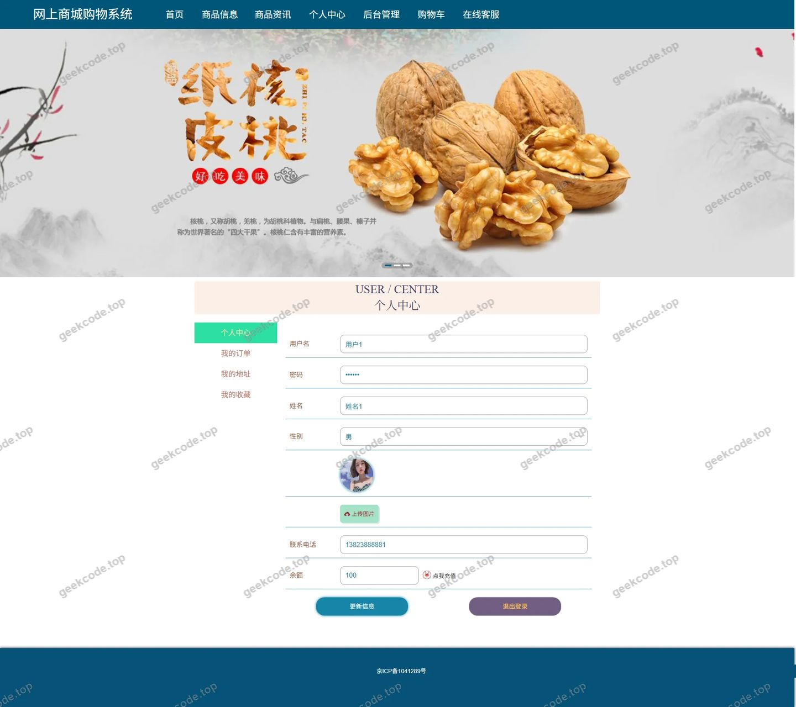</a>

<h4>前台-我的地址列表</h4>

<a href="https://geekcode.top/archives/%E7%BD%91%E4%B8%8A%E5%95%86%E5%9F%8E%E8%B4%AD%E7%89%A9%E7%B3%BB%E7%BB%9F?utm_source=github" title="查看完整源码">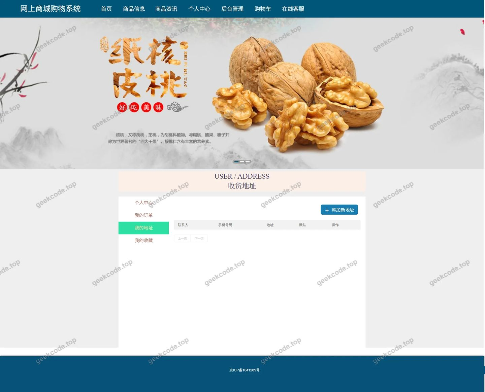</a>

<h4>前台-我的订单列表</h4>

<a href="https://geekcode.top/archives/%E7%BD%91%E4%B8%8A%E5%95%86%E5%9F%8E%E8%B4%AD%E7%89%A9%E7%B3%BB%E7%BB%9F?utm_source=github" title="查看完整源码">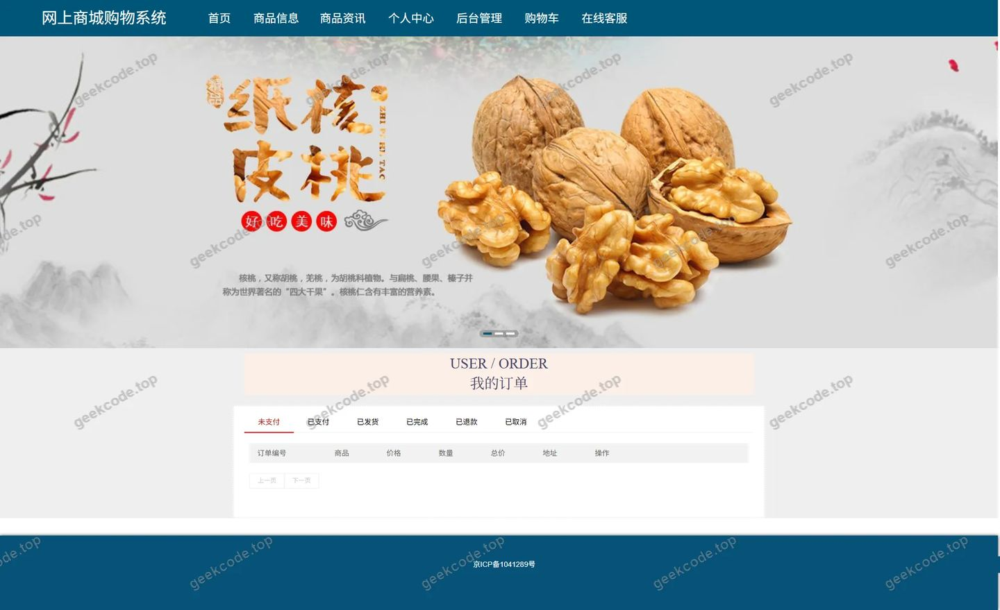</a>

<h4>前台-我的收藏列表</h4>

<h4>前台-商品资讯-详情</h4>

<h4>前台-商品信息-详情</h4>

<a href="https://geekcode.top/archives/%E7%BD%91%E4%B8%8A%E5%95%86%E5%9F%8E%E8%B4%AD%E7%89%A9%E7%B3%BB%E7%BB%9F?utm_source=github" title="查看完整源码">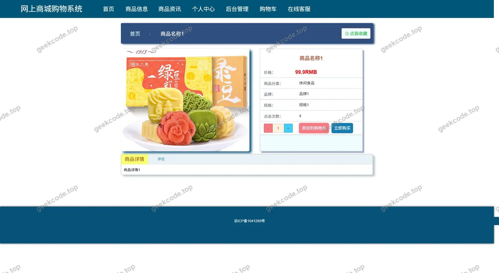</a>

<h4>前台-订单评价列表</h4>

<h4>前台-商品分类列表</h4>

<h4>前台-购物车列表</h4>

<a href="https://geekcode.top/archives/%E7%BD%91%E4%B8%8A%E5%95%86%E5%9F%8E%E8%B4%AD%E7%89%A9%E7%B3%BB%E7%BB%9F?utm_source=github" title="查看完整源码">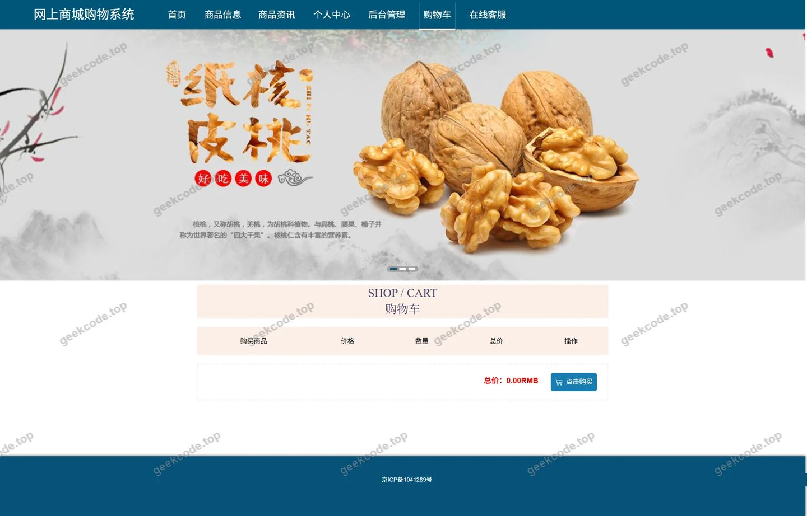</a>

<h4>前台-订单评价-详情</h4>

<a href="https://geekcode.top/archives/%E7%BD%91%E4%B8%8A%E5%95%86%E5%9F%8E%E8%B4%AD%E7%89%A9%E7%B3%BB%E7%BB%9F?utm_source=github" title="查看完整源码">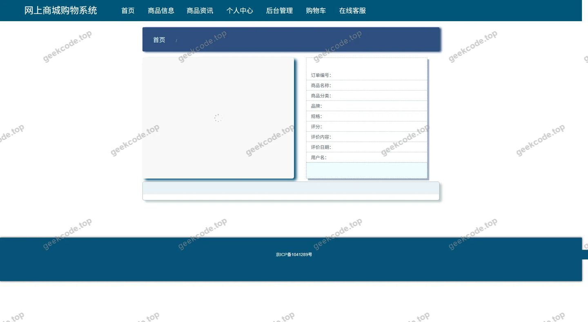</a>

<h4>前台-商品信息评论-详情</h4>

<a href="https://geekcode.top/archives/%E7%BD%91%E4%B8%8A%E5%95%86%E5%9F%8E%E8%B4%AD%E7%89%A9%E7%B3%BB%E7%BB%9F?utm_source=github" title="查看完整源码">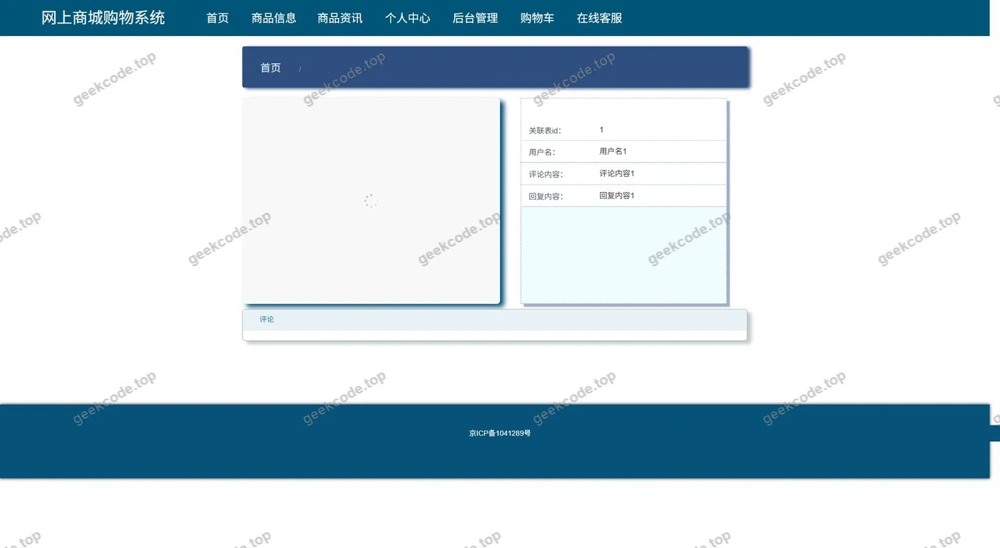</a>

<h3>后台管理端</h3>
<h4>后台-在线客服</h4>

<a href="https://geekcode.top/archives/%E7%BD%91%E4%B8%8A%E5%95%86%E5%9F%8E%E8%B4%AD%E7%89%A9%E7%B3%BB%E7%BB%9F?utm_source=github" title="查看完整源码">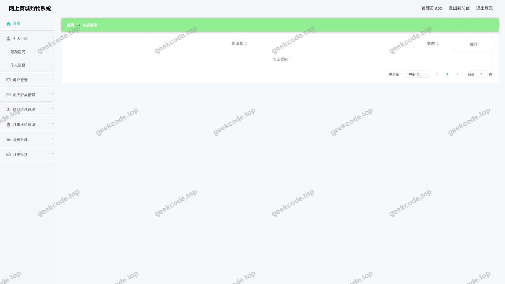</a>

<h4>后台-系统配置</h4>

<a href="https://geekcode.top/archives/%E7%BD%91%E4%B8%8A%E5%95%86%E5%9F%8E%E8%B4%AD%E7%89%A9%E7%B3%BB%E7%BB%9F?utm_source=github" title="查看完整源码">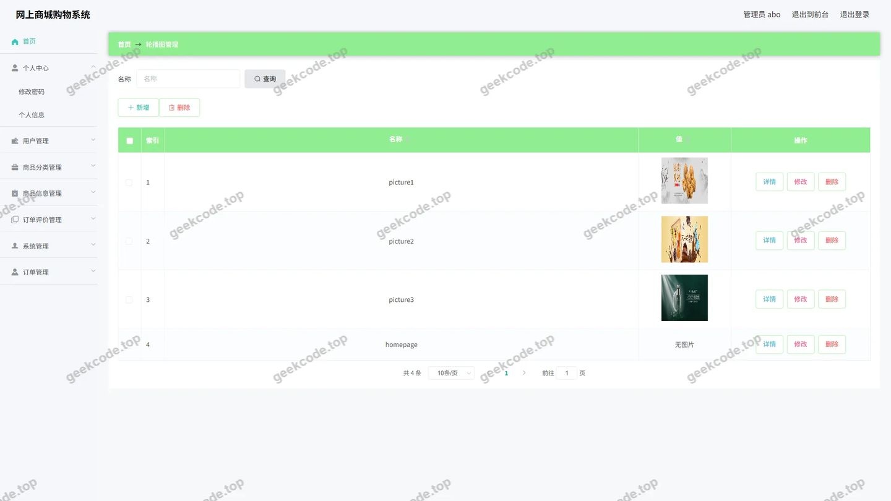</a>

<h4>后台-订单评价</h4>

<a href="https://geekcode.top/archives/%E7%BD%91%E4%B8%8A%E5%95%86%E5%9F%8E%E8%B4%AD%E7%89%A9%E7%B3%BB%E7%BB%9F?utm_source=github" title="查看完整源码">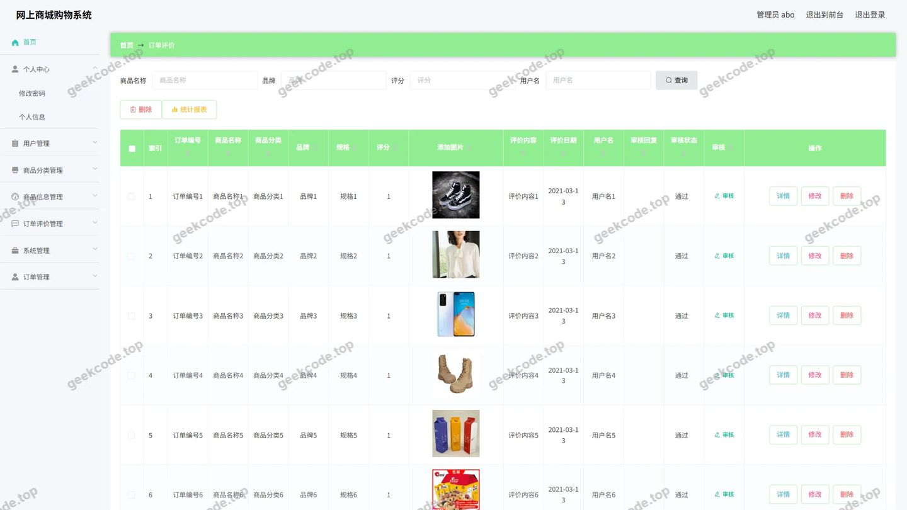</a>

<h4>后台-商品信息评论</h4>

<a href="https://geekcode.top/archives/%E7%BD%91%E4%B8%8A%E5%95%86%E5%9F%8E%E8%B4%AD%E7%89%A9%E7%B3%BB%E7%BB%9F?utm_source=github" title="查看完整源码">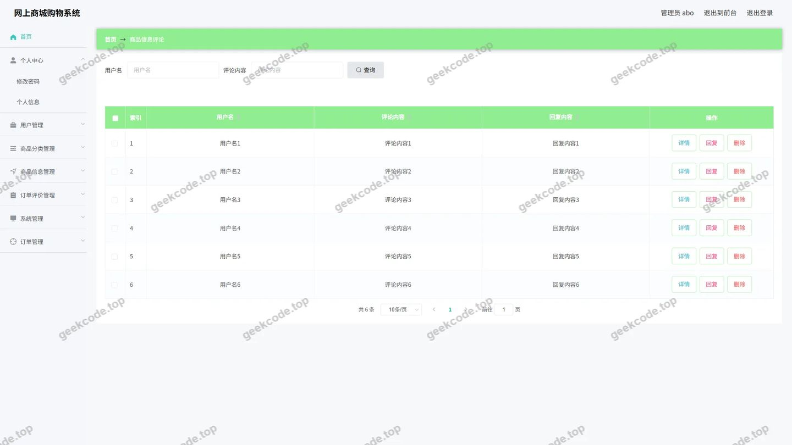</a>

<h4>后台首页</h4>

<a href="https://geekcode.top/archives/%E7%BD%91%E4%B8%8A%E5%95%86%E5%9F%8E%E8%B4%AD%E7%89%A9%E7%B3%BB%E7%BB%9F?utm_source=github" title="查看完整源码">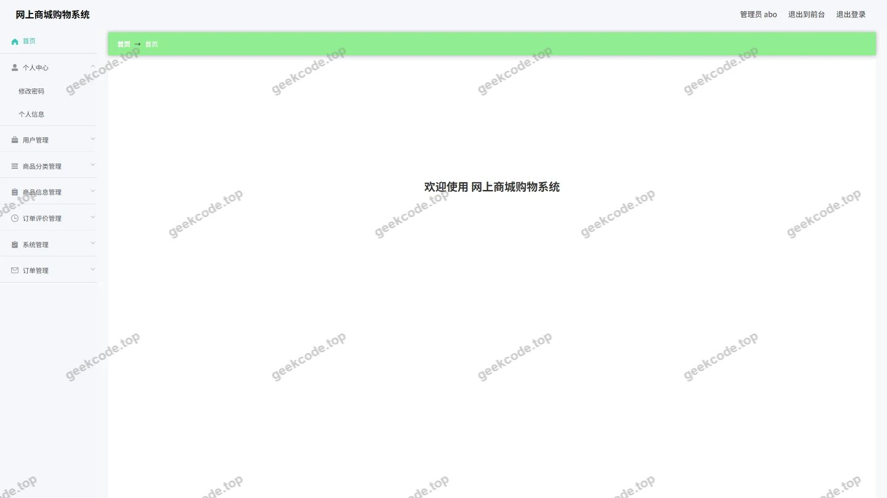</a>

<h4>后台-登录</h4>

<h4>后台-公告信息</h4>

<a href="https://geekcode.top/archives/%E7%BD%91%E4%B8%8A%E5%95%86%E5%9F%8E%E8%B4%AD%E7%89%A9%E7%B3%BB%E7%BB%9F?utm_source=github" title="查看完整源码">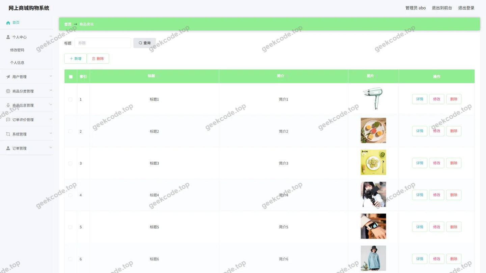</a>

<h4>后台-订单-状态</h4>

<a href="https://geekcode.top/archives/%E7%BD%91%E4%B8%8A%E5%95%86%E5%9F%8E%E8%B4%AD%E7%89%A9%E7%B3%BB%E7%BB%9F?utm_source=github" title="查看完整源码">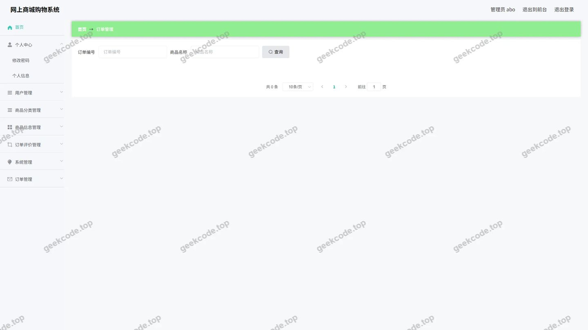</a>

<h4>后台-商品分类</h4>

<a href="https://geekcode.top/archives/%E7%BD%91%E4%B8%8A%E5%95%86%E5%9F%8E%E8%B4%AD%E7%89%A9%E7%B3%BB%E7%BB%9F?utm_source=github" title="查看完整源码">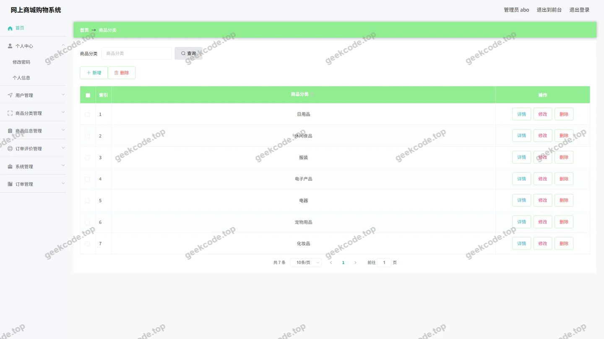</a>

<h4>后台-商品信息</h4>

<a href="https://geekcode.top/archives/%E7%BD%91%E4%B8%8A%E5%95%86%E5%9F%8E%E8%B4%AD%E7%89%A9%E7%B3%BB%E7%BB%9F?utm_source=github" title="查看完整源码">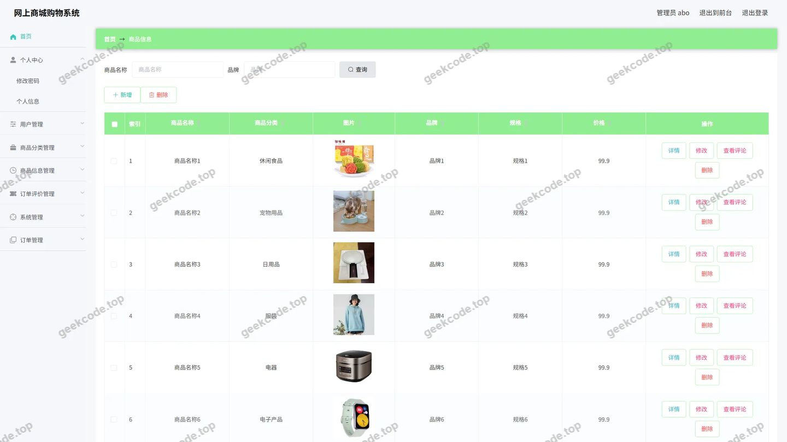</a>

<h4>后台-收藏</h4>

<a href="https://geekcode.top/archives/%E7%BD%91%E4%B8%8A%E5%95%86%E5%9F%8E%E8%B4%AD%E7%89%A9%E7%B3%BB%E7%BB%9F?utm_source=github" title="查看完整源码">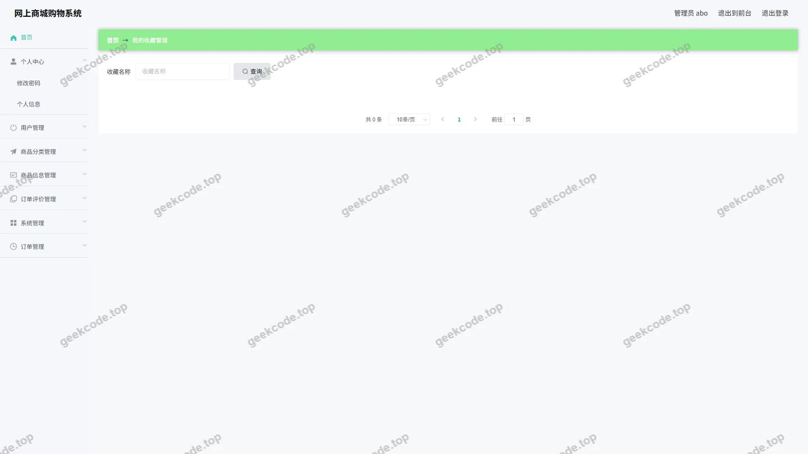</a>

---

## 获取完整源码

| 项目 | 说明 |
| --- | --- |
| 项目名 | 网上商城购物系统 |
| 运行截图 | 本文 28 张（站点带水印原图，仓库 `images/` 目录） |
| 完整源码 | [https://geekcode.top/archives/%E7%BD%91%E4%B8%8A%E5%95%86%E5%9F%8E%E8%B4%AD%E7%89%A9%E7%B3%BB%E7%BB%9F?utm_source=github](https://geekcode.top/archives/%E7%BD%91%E4%B8%8A%E5%95%86%E5%9F%8E%E8%B4%AD%E7%89%A9%E7%B3%BB%E7%BB%9F?utm_source=github) |
| 咨询微信 | **ir9372**（备注：jingpin-yuanma） |
| 更多项目 | [极客代码 geekcode.top](https://geekcode.top/?utm_source=github) |

> 需要源码、部署、改配置、跑不起来等问题，加微信 ir9372 沟通，说明项目名即可。
